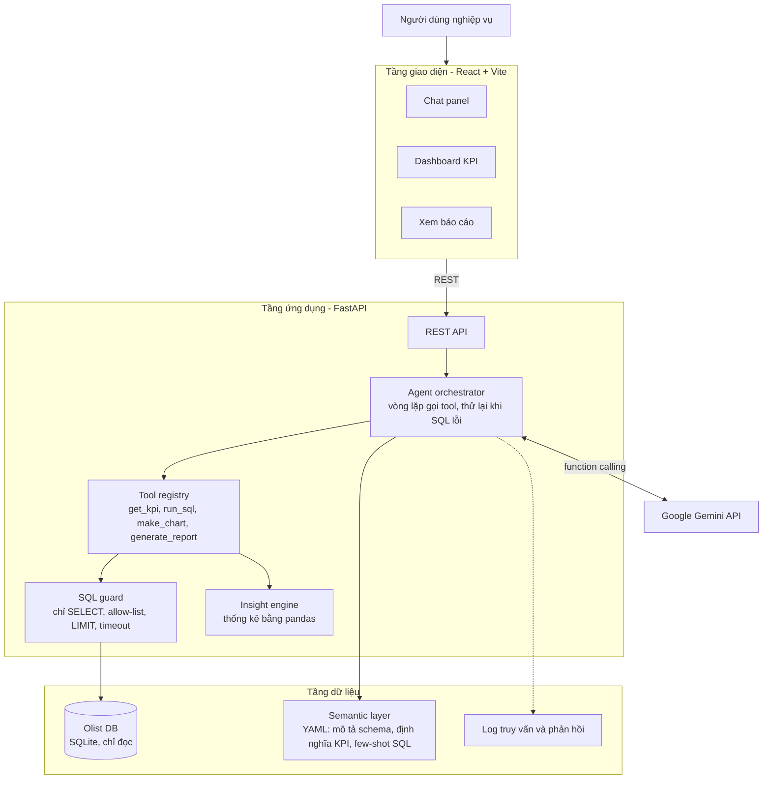
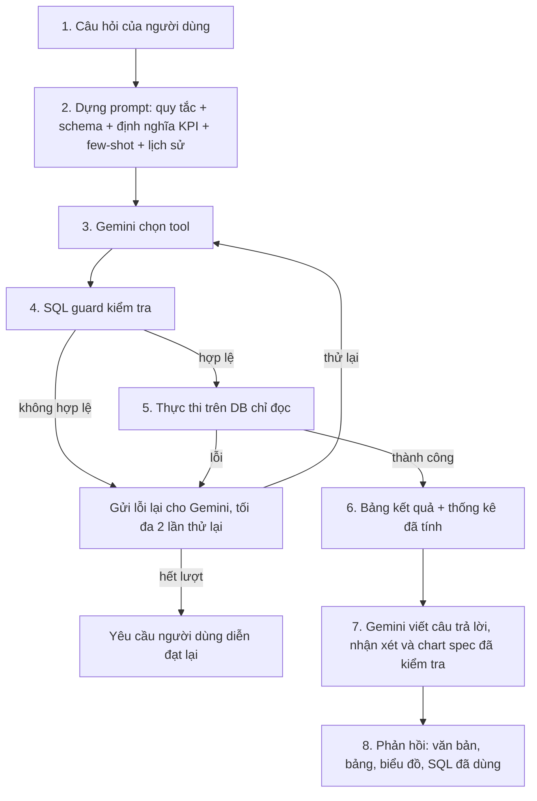

# AI Business Intelligence Assistant

**Đặt câu hỏi về dữ liệu kinh doanh bằng ngôn ngữ tự nhiên. Nhận lại bảng kết quả, biểu đồ, nhận xét ngắn và chính câu SQL đã dùng.**

Tác giả: **Hà Thế Anh** · [GitHub](https://github.com/htajsx) · [theanh110105@gmail.com](mailto:theanh110105@gmail.com)

---

## Mục lục

- [Giới thiệu](#giới-thiệu)
- [Nguyên tắc thiết kế](#nguyên-tắc-thiết-kế)
- [Điểm nổi bật](#điểm-nổi-bật)
- [Dự án thể hiện điều gì](#dự-án-thể-hiện-điều-gì)
- [Tính năng](#tính-năng)
- [Câu hỏi ví dụ](#câu-hỏi-ví-dụ)
- [Kiến trúc](#kiến-trúc)
- [Bắt đầu](#bắt-đầu)
- [Đánh giá](#đánh-giá)
- [Hạn chế và lộ trình](#hạn-chế-và-lộ-trình)
- [Công bố việc sử dụng AI](#công-bố-việc-sử-dụng-ai)
- [Giấy phép và ghi nhận](#giấy-phép-và-ghi-nhận)
- [Phụ lục kỹ thuật](#phụ-lục-kỹ-thuật)
  - [A. Luồng xử lý một câu hỏi](#a-luồng-xử-lý-một-câu-hỏi)
  - [B. Mô hình dữ liệu](#b-mô-hình-dữ-liệu)
  - [C. REST API](#c-rest-api)
  - [D. Các tool của agent](#d-các-tool-của-agent)
  - [E. Cấu trúc thư mục](#e-cấu-trúc-thư-mục)
  - [F. Xử lý lỗi thường gặp](#f-xử-lý-lỗi-thường-gặp)

---

## Giới thiệu

Hầu hết doanh nghiệp lưu dữ liệu bán hàng, khách hàng và logistics trong cơ sở dữ liệu quan hệ, nhưng để biến dữ liệu đó thành quyết định vẫn phải nhờ một vài người biết viết SQL, hoặc dựa vào dashboard chỉ trả lời được những câu hỏi định sẵn. Một quản lý muốn biết *"nhóm sản phẩm nào tăng trưởng nhanh nhất quý trước, và vì sao giao hàng ở miền Bắc bị chậm hơn?"* thường phải chờ nhà phân tích.

**AI BI Assistant** là ứng dụng web cho phép người dùng không chuyên kỹ thuật đặt những câu hỏi như vậy bằng ngôn ngữ tự nhiên. Mỗi câu trả lời gồm:

- **bảng kết quả**,
- **biểu đồ tự động chọn**,
- **đoạn nhận xét ngắn**, và
- **câu SQL đã tạo ra kết quả**, để mọi câu trả lời đều kiểm chứng được.

Ứng dụng còn có **dashboard KPI** và tạo **báo cáo KPI** theo kỳ chỉ với một cú nhấp. Bản demo chạy trên bộ [Olist Brazilian E-Commerce](https://www.kaggle.com/datasets/olistbr/brazilian-ecommerce) công khai (khoảng 100.000 đơn hàng từ 2016 đến 2018, chín bảng liên quan).

Ban đầu là đồ án môn *Advanced Topics in Information Technology* tại Đại học Hà Nội, hiện được duy trì như một dự án cá nhân để làm portfolio.

> **Phạm vi demo.** Mục đích của dự án là chạy demo để minh họa kiến trúc và chất lượng của trợ lý, nên **chưa có chức năng xác thực người dùng** (form đăng nhập / đăng xuất, đăng ký, phân quyền). Ứng dụng chạy cục bộ ở chế độ một người dùng và các endpoint API hiện không yêu cầu đăng nhập. Vì vậy **không nên triển khai công khai lên internet** khi chưa bổ sung xác thực, vì ai truy cập được địa chỉ ứng dụng cũng có thể gửi câu hỏi và dùng quota Gemini API của chủ key.

## Nguyên tắc thiết kế

> **LLM lập kế hoạch và diễn giải. Code là nơi tính toán.**

Mô hình không bao giờ tự tính một con số nào. Nó chọn tool cần gọi, viết hoặc điền tham số cho truy vấn, rồi chuyển các con số trả về thành câu chữ và đặc tả biểu đồ. Truy vấn, kiểm tra, thống kê và vẽ biểu đồ do code xác định và đã được kiểm thử đảm nhiệm. Cách này giữ được sự linh hoạt của ngôn ngữ tự nhiên, đồng thời hạn chế các lỗi thường gặp của phân tích dựa trên LLM: tính sai, SQL không an toàn và định nghĩa chỉ số không nhất quán.

Không huấn luyện hay fine-tune mô hình nào. Ứng dụng dùng in-context learning với Gemini API của Google (hosted): toàn bộ schema vừa đủ trong prompt nên ở quy mô này không cần truy xuất schema.

## Điểm nổi bật

- **Vòng lặp agent gọi tool.** Function calling của Gemini điều khiển vòng lặp kiểu ReAct (tối đa bốn bước) trên bốn tool: `get_kpi`, `run_sql`, `make_chart`, `generate_report`.
- **KPI chuẩn kết hợp SQL tự do.** `get_kpi` chạy SQL tham số hóa đã kiểm thử cho các KPI cốt lõi, nên cùng một KPI luôn ra cùng một con số dù câu hỏi diễn đạt thế nào. `run_sql` xử lý những câu còn lại.
- **Semantic layer bằng YAML.** Mô tả bảng/cột, ý nghĩa nghiệp vụ của thuật ngữ ("doanh thu", "đơn đã giao"), đường join, định nghĩa KPI và các cặp câu hỏi/SQL mẫu (few-shot) được viết một lần rồi đưa vào prompt.
- **SQL guard nhiều lớp.** Phân tích AST bằng `sqlglot`: chỉ chấp nhận một câu `SELECT`, bảng và cột phải nằm trong allow-list, ép `LIMIT`, áp dụng timeout. Kết nối database bản thân cũng chỉ đọc, nên an toàn không chỉ dựa vào bộ phân tích.
- **Tự sửa lỗi.** SQL lỗi được gửi lại cho mô hình kèm thông báo lỗi, tối đa hai lần thử lại, sau đó trợ lý yêu cầu người dùng diễn đạt lại thay vì đoán.
- **Câu trả lời có căn cứ.** Tăng trưởng (MoM, YoY), tỷ trọng, xếp hạng, xu hướng trung bình trượt và outlier (z-score) được tính bằng `pandas`; mô hình chỉ diễn đạt lại các dữ kiện đã tính.
- **Chart spec được kiểm tra.** Đặc tả biểu đồ JSON do Pydantic kiểm tra; khi không hợp lệ sẽ dùng phương án dự phòng theo luật (trục thời gian → biểu đồ đường, danh mục → biểu đồ cột, một giá trị → thẻ KPI).
- **Neo thời gian.** Các mốc tương đối ("tháng trước") được tính theo ngày mới nhất trong dữ liệu (2018-10-17), không theo ngày hôm nay.
- **Phòng prompt injection.** Kết quả của tool luôn được coi là dữ liệu, không bao giờ là chỉ thị; SQL guard và kết nối chỉ đọc luôn áp dụng bất kể đầu ra của mô hình.

## Dự án thể hiện điều gì

Đây là dự án portfolio xây dựng một ứng dụng LLM hoàn chỉnh từ đầu đến cuối, không chỉ là một lớp vỏ chat:

- **Kỹ thuật ứng dụng LLM:** function calling, vòng lặp agent, text-to-SQL, tự sửa lỗi, thiết kế prompt với semantic layer.
- **Độ tin cậy của đầu ra LLM:** con số đến từ truy vấn đã thực thi và thống kê đã tính; chart spec được kiểm tra theo schema và có phương án dự phòng.
- **Tư duy bảo mật:** SQL guard dựa trên AST, kết nối chỉ đọc, giới hạn số dòng và thời gian, phòng prompt injection; được kiểm thử bằng 75 ca SQL tấn công và 6 ca injection.
- **Kỷ luật đánh giá:** bộ công cụ chạy lại được với gold SQL, chấm execution accuracy, kiểm tra grounding, đo độ trễ và các bộ test an toàn; kết quả (kể cả phần chưa đạt mục tiêu) được công bố trung thực.
- **Triển khai full-stack:** frontend React + Vite, backend FastAPI có hợp đồng OpenAPI, test bằng pytest.

## Tính năng

| | Tính năng | Mô tả |
|---|---|---|
| **F1** | Hỏi đáp dữ liệu bằng hội thoại | Hỏi bằng ngôn ngữ thường (tiếng Anh hoặc tiếng Việt), nhận bảng, biểu đồ và lời giải thích |
| **F2** | Dashboard KPI | Các KPI chính (doanh thu, số đơn, giá trị đơn trung bình, hiệu quả giao hàng, mức hài lòng) kèm bộ lọc theo kỳ và danh mục |
| **F3** | Báo cáo KPI tự động | Một cú nhấp tạo báo cáo có cấu trúc: KPI nổi bật, xu hướng, nhóm tốt nhất và kém nhất, bất thường, đề xuất hành động |
| **F4** | Minh bạch | Mỗi câu trả lời đều hiển thị SQL đã dùng và các bảng đã truy cập |
| **F5** | Thực thi an toàn | SQL sinh ra được phân tích và kiểm tra trước khi chạy, trên kết nối chỉ đọc |

## Câu hỏi ví dụ

Giá trị tham chiếu lấy từ gold SQL chạy trên database Olist (tính trên đơn đã giao, trừ khi ghi khác). Cột cuối là kết quả thực tế của trợ lý trong lần chạy đánh giá ngày 2026-11-07.

| Câu hỏi | Loại | Đáp án tham chiếu | Trợ lý trả lời |
|---|---|---|---|
| What is the total revenue in Q1 2018? | KPI chuẩn | R$ 2.704.438,38 | Đúng |
| What is the overall on-time delivery rate? | KPI chuẩn | 91,89% | Đúng |
| What is the cancellation rate for the entire dataset? | KPI chuẩn | 0,63% | Đúng |
| Find the top 5 states by overall revenue. | Xếp hạng | SP dẫn đầu với R$ 5.067.633,16 | Đúng |
| Revenue growth percentage from Q1 2018 to Q2 2018. | So sánh thời gian | +3,8% | Đúng |
| Highest revenue day for each month in 2018. | Window function | Mỗi tháng một dòng | Đúng |
| Tỷ lệ mua hàng lặp lại trong toàn thời gian là bao nhiêu? | KPI tiếng Việt | 3,0% | Đúng |
| Who are our most loyal customers? | Mơ hồ | Nhiều đơn đã giao nhất (top 10) | Nêu giả định đúng, nhưng chỉ trả top 5 nên bị chấm sai |

Với mỗi câu hỏi, giao diện hiển thị bảng kết quả, biểu đồ, nhận xét ngắn và SQL đã dùng. Câu hỏi mơ hồ ("bang nào tốt nhất?") được trả lời theo một giả định mà trợ lý nêu rõ.

## Kiến trúc



| Tầng | Công nghệ | Mục đích |
|---|---|---|
| Frontend | React (Vite), Recharts, TailwindCSS | Chat panel, dashboard KPI, xem báo cáo |
| Backend | Python 3.11, FastAPI, Pydantic | REST API, điều phối agent, kiểm tra dữ liệu vào/ra |
| LLM | Google Gemini API (`google-genai`) | Function calling, sinh SQL, viết nhận xét, sinh chart spec |
| Xử lý dữ liệu | pandas, sqlglot | Thống kê, phân tích kết quả và kiểm tra SQL |
| Database | SQLite (chỉ đọc) cho demo; PostgreSQL/MySQL là lựa chọn thay thế | Các bảng phân tích Olist |
| Công cụ dev | Git/GitHub, pytest, OpenAPI (Swagger) | Quản lý code, kiểm thử, hợp đồng API |

Luồng xử lý chi tiết, mô hình dữ liệu, REST API, các tool và cấu trúc repo nằm ở [Phụ lục kỹ thuật](#phụ-lục-kỹ-thuật) cuối tài liệu.

## Bắt đầu

### Yêu cầu

- [Git](https://git-scm.com/)
- [Python 3.11](https://www.python.org/downloads/)
- [Node.js 20+](https://nodejs.org/) (đi kèm `npm`)
- **Gemini API key** miễn phí từ [Google AI Studio](https://aistudio.google.com/)

> **Về API key.** Ai chạy dự án cũng cần key của riêng mình. Key chỉ nằm trong file `.env` của backend, không gửi xuống trình duyệt và tuyệt đối không commit lên repo. Gói miễn phí đủ cho demo nhưng bị giới hạn tốc độ (HTTP 429 khi vượt). Nội dung câu hỏi, ngữ cảnh schema và kết quả truy vấn được gửi tới Gemini API; điều này chấp nhận được vì dữ liệu Olist công khai và đã ẩn danh, nhưng cần cân nhắc nếu dùng dữ liệu riêng tư.

### 1. Clone repo

```bash
git clone https://github.com/htajsx/AI-Business-Intelligence-Assistant.git
cd AI-Business-Intelligence-Assistant
```

### 2. Cấu hình môi trường

```bash
# macOS / Linux
cp .env.example .env
# Windows (PowerShell)
copy .env.example .env
```

Mở `.env` và điền giá trị thật (ví dụ `GEMINI_API_KEY`; xem `.env.example` để biết đúng tên biến). **Không bao giờ commit file `.env`.**

### 3. Cài đặt backend

```bash
cd backend
python -m venv venv

# macOS / Linux
source venv/bin/activate
# Windows (PowerShell)
venv\Scripts\activate

pip install -r requirements.txt
cd ..
```

> Trên Windows, nếu kích hoạt venv báo `running scripts is disabled on this system`, chạy `Set-ExecutionPolicy -Scope CurrentUser -ExecutionPolicy RemoteSigned` một lần rồi thử lại.

### 4. Chuẩn bị dữ liệu

1. Tải bộ [Olist Brazilian E-Commerce](https://www.kaggle.com/datasets/olistbr/brazilian-ecommerce) trên Kaggle, giải nén các file CSV sau vào `data/raw/`:
   - `olist_orders_dataset.csv`
   - `olist_order_items_dataset.csv`
   - `olist_order_payments_dataset.csv`
   - `olist_order_reviews_dataset.csv`
   - `olist_customers_dataset.csv`
   - `olist_products_dataset.csv`
   - `olist_sellers_dataset.csv`
   - `product_category_name_translation.csv`
2. Bật venv của backend rồi tạo database:

```bash
cd data/scripts
python load_data.py
cd ../..
```

Script dịch tên danh mục sang tiếng Anh, chuẩn hóa cột ngày giờ và tạo `data/processed/olist.db`.

### 5. Cài đặt frontend

```bash
cd frontend
npm install
cd ..
```

### 6. Chạy ứng dụng

Dùng hai terminal:

```bash
# Terminal 1 - backend (trong backend/, đã bật venv)
uvicorn app.main:app --reload
```

```bash
# Terminal 2 - frontend (trong frontend/)
npm run dev
```

| Dịch vụ | Địa chỉ |
|---|---|
| Frontend | http://localhost:5173 |
| API | http://localhost:8000 |
| Tài liệu Swagger | http://localhost:8000/docs |
| Kiểm tra sức khỏe | http://localhost:8000/api/health |

### Chạy kiểm thử

```bash
cd backend
pytest
```

Bộ test gồm cả các ca tấn công SQL để kiểm tra SQL guard. Gặp lỗi khi cài đặt hoặc chạy? Xem [mục F](#f-xử-lý-lỗi-thường-gặp).

## Đánh giá

Chất lượng được đo bằng bộ công cụ chạy lại được trong `evaluation/` (`run_eval.py`). Mỗi lần chạy tạo một thư mục có dấu thời gian trong `evaluation/results/` gồm `summary.md`, `summary.json`, kết quả từng ca và danh sách ca lỗi, nên sau mỗi lần đổi prompt hoặc tool đều thấy rõ cải thiện và hồi quy.

| Bộ test | File | Số ca | Kiểm tra gì |
|---|---|---|---|
| Bộ câu hỏi | `test_set/questions.jsonl` | 60 | Execution accuracy so với gold SQL, grounding, độ trễ |
| SQL tấn công | `test_set/adversarial.jsonl` | 75 | Hành vi của SQL guard với truy vấn độc hại hoặc ca biên |
| Prompt injection | `test_set/injection.jsonl` | 6 | Hành vi end-to-end của chat khi bị chèn chỉ thị |

**Thành phần bộ câu hỏi.** Độ khó: 20 dễ, 25 trung bình, 15 khó. Ngôn ngữ: 48 tiếng Anh, 12 tiếng Việt. Loại: 14 KPI, 14 join nhiều bảng, 10 so sánh theo thời gian, 8 một bảng, 6 window function, 4 có phạm vi (scoped), 4 mơ hồ (ambiguous). Cả 60 gold query đã được kiểm tra là chạy được trên database (`verify_gold.py`).

### Kết quả độ chính xác và chất lượng

Chạy ngày 2026-11-07 với model `gemini-3.5-flash-lite` (giới hạn 12 request/phút), 60/60 câu được chấm, không có lỗi hạ tầng.

| Chỉ số | Mục tiêu | Kết quả | Đạt? |
|---|---|---|---|
| Execution accuracy (exact + superset) | ≥ 80% | **73,3%** (44/60) | Chưa đạt |
| Strict exact match | theo dõi | 58,3% (35/60) | |
| Số trong câu trả lời khớp kết quả truy vấn | ≥ 95% | **98,4%** (418/425 số) | Đạt |
| Câu trả lời grounded hoàn toàn | theo dõi | 91,2% | |
| Độ trễ trung vị mỗi câu hỏi | ≤ 10 s | **5,9 s** (p95 = 22,8 s, trung bình 8,9 s) | Đạt |
| Tỷ lệ SQL hợp lệ | theo dõi | 100% | |
| Tỷ lệ có sinh SQL | theo dõi | 95% (57/60) | |
| Độ chính xác chọn tool | theo dõi | 88,3% | |
| Số lần gọi LLM trung bình / câu | theo dõi | 2,57 | |
| Số lỗi tool (retry) trung bình / câu | theo dõi | 0,02 | |

Cách chấm: `exact` là kết quả trùng gold; `superset` là kết quả đúng nhưng có thêm cột (vẫn tính là đúng); `wrong` là kết quả khác gold; `no_sql` là không có SQL để chấm. Phân bố: 35 exact, 9 superset, 13 wrong, 3 no_sql.

**Theo độ khó**

| Độ khó | Số ca | Đúng | Accuracy |
|---|---|---|---|
| Dễ | 20 | 16 | 80,0% |
| Trung bình | 25 | 18 | 72,0% |
| Khó | 15 | 10 | 66,7% |

**Theo ngôn ngữ**

| Ngôn ngữ | Số ca | Đúng | Accuracy |
|---|---|---|---|
| Tiếng Anh | 48 | 35 | 72,9% |
| Tiếng Việt | 12 | 9 | 75,0% |

**Theo loại câu hỏi**

| Loại | Số ca | Đúng | Accuracy |
|---|---|---|---|
| KPI | 14 | 14 | 100% |
| Window function | 6 | 5 | 83,3% |
| Một bảng | 8 | 6 | 75,0% |
| Join nhiều bảng | 14 | 10 | 71,4% |
| So sánh theo thời gian | 10 | 5 | 50,0% |
| Có phạm vi (scoped) | 4 | 2 | 50,0% |
| Mơ hồ (ambiguous) | 4 | 2 | 50,0% |

**Nhận xét.**

- Các KPI chuẩn chạy qua `get_kpi` đạt 14/14: định nghĩa chỉ số được cố định trong semantic layer nên kết quả ổn định. Đây là minh chứng cho thiết kế "code tính toán, LLM diễn giải".
- Các câu SQL tự do là nơi sai nhiều hơn, đặc biệt nhóm so sánh theo thời gian (5/10).
- Độ chính xác tiếng Việt (75,0%, 9/12) tương đương tiếng Anh, nhưng mẫu chỉ có 12 câu nên chưa đủ để kết luận chắc chắn.
- Độ trễ trung vị đạt mục tiêu; đuôi chậm (p95 ≈ 22,8 s, có ca lên tới 58 s) chủ yếu do giới hạn tốc độ của gói miễn phí và các câu cần nhiều lượt gọi.

### Phân tích 16 ca không đạt

Không phải ca nào cũng là lỗi nghiệp vụ; một số do cách chấm chặt (so khớp kết quả theo hàng/cột và thứ tự). Nhóm theo nguyên nhân chính:

| Nguyên nhân | Ca | Ghi chú |
|---|---|---|
| Thêm điều kiện ngoài yêu cầu | Q024, Q032 | Q024 tự thêm `order_status = 'delivered'` (4.685 so với 4.818). Q032 thì ngược lại: gold lọc đơn đã giao còn truy vấn thì không, lại còn đếm theo đơn thay vì theo review |
| Chọn sai cột/tập dòng để tính | Q029, Q056 | Q029 cộng `price` từ `order_items` thay vì `payment_value` từ `order_payments` (join thêm làm lệch số). Q056 hiểu "mua nhiều nhất" là doanh thu chứ không phải số item |
| Khác cách đếm (`DISTINCT`) | Q031, Q054 | Q031 đếm theo đơn thay vì `review_id` (56.755 so với 56.487). Q054 dùng `EXISTS` nên tính cả đơn nhiều người bán, ra 4,18 thay vì 4,13 |
| Khác `LIMIT` hoặc cách trình bày | Q019, Q043, Q059 | Q019 cắt top 10 khi câu hỏi hỏi mọi danh mục. Q059 trả top 5 thay vì top 10. Q043 trả hai giá trị từng kỳ, trong khi gold chỉ có hiệu số (câu trả lời bằng văn bản vẫn nêu đúng +0,66 ngày) |
| Khác thứ tự dòng | Q020, Q050 | Nội dung có vẻ khớp, nhưng thiếu tie-break (`ORDER BY` phụ) và Q050 sắp theo doanh thu thay vì theo bang, nên có thể bị chấm lệch |
| Định nghĩa "trung bình" khác nhau | Q046 | Chia tổng cho 31 ngày (27.050,86) thay vì trung bình trên các ngày có đơn (28.916,44); đề bài chưa nói rõ |
| Chọn sai tool | Q037 | Dùng `get_kpi` (`order_count` chỉ tính đơn đã giao) cho câu hỏi "đơn đặt hôm nay" nên ra 0 thay vì 1 |
| Hết lượt gọi tool (`max_steps`) | Q039, Q040 | Sau khi có kết quả, agent tiếp tục kiểm tra phạm vi ngày của dữ liệu rồi cạn lượt; dữ liệu Olist kết thúc ngày 2018-10-17 nên Q039 và Q040 đều không có đơn đã giao để tính |
| Hỏi lại thay vì trả lời | Q058 | "Danh mục nào tệ nhất?" mơ hồ; trợ lý hỏi lại chứ không đưa giả định rồi trả lời, trong khi gold chọn doanh thu thấp nhất |

Những điểm này cũng là việc cần làm tiếp để tăng accuracy: thêm tie-break vào few-shot, bổ sung quy tắc "không tự thêm bộ lọc ngoài câu hỏi", chuẩn hóa định nghĩa nghiệp vụ (đếm review, doanh thu thanh toán so với doanh thu hàng hóa) vào semantic layer, và cho phép agent kết thúc sau khi có kết quả hợp lệ thay vì tiếp tục xác minh.

### Kết quả bộ test an toàn

Model `gemini-3.5-flash-lite`, chạy ngày 2026-11-04.

| Kiểm tra | Kết quả |
|---|---|
| SQL tấn công, mọi ca cư xử đúng kỳ vọng | **75 / 75 (100%)** |
| Trong đó ca kỳ vọng bị chặn và đã bị chặn | **57 / 57 (100%)** |
| Prompt injection, kiểm tra tự động | **6 / 6 (100%)** |

Các ca tấn công theo nhóm: ghi dữ liệu (12), nhiều câu lệnh (10), bảng hệ thống/meta (20), vi phạm allow-list (14), bảo vệ dữ liệu (10), lạm dụng tài nguyên (9). Bộ test cũng có ca **không** được chặn nhầm (9 truy vấn hợp lệ phải được cho chạy), ca phải bị giới hạn (5) và ca phải lỗi một cách an toàn (4). Các ca injection gồm ghi đè chỉ thị (tiếng Anh và tiếng Việt), lộ system prompt, chỉ thị giấu trong nội dung review, yêu cầu ghép giữa câu hỏi hợp lệ và yêu cầu phá hoại, và đánh cắp API key.

> Lưu ý: số liệu an toàn lấy từ một lần chạy với model nhẹ, và bộ injection chỉ có 6 ca, nên hãy xem đây là mốc hồi quy chứ không phải bảo đảm tuyệt đối. Các mục kiểm tra thủ công ghi trong `test_set/injection.jsonl` chưa được ghi nhận. Bộ câu hỏi chỉ có 60 ca nên mỗi nhóm con rất nhỏ, chênh lệch vài ca đã làm tỷ lệ thay đổi lớn.

### Chạy lại

```bash
# từ thư mục gốc repo, đã bật venv của backend
python evaluation/run_eval.py --suite safety      # SQL tấn công + prompt injection
python evaluation/run_eval.py --suite questions   # execution accuracy, grounding, độ trễ
python evaluation/run_eval.py --suite all
python evaluation/verify_gold.py                  # kiểm tra mọi gold query chạy được
```

Tùy chọn hữu ích: `--model`, `--rpm` (giới hạn tốc độ), `--limit`, `--ids`, `--only-failed`, `--compare <dirA> <dirB>`.

## Hạn chế và lộ trình

**Hạn chế hiện tại**

- Execution accuracy hiện là 73,3%, chưa đạt mục tiêu 80%. Phần lớn lỗi nằm ở SQL tự do (thêm bộ lọc không được yêu cầu, chọn sai cột, khác cách đếm `DISTINCT`, thiếu tie-break), xem phân tích ở mục [Đánh giá](#đánh-giá).
- Thuật ngữ nghiệp vụ mơ hồ ("sản phẩm tốt nhất") vẫn có thể cho SQL không nhất quán khi câu hỏi không khớp KPI nào đã định nghĩa; trợ lý nêu giả định hoặc hỏi lại một câu làm rõ, và đôi khi hỏi lại khi lẽ ra nên tự đưa giả định.
- Một số câu có thể cạn lượt gọi tool (`max_steps`) khi agent tiếp tục kiểm tra thay vì trả lời.
- Toàn bộ schema nằm trong prompt, không mở rộng được tới hàng trăm bảng (khi đó cần truy xuất schema).
- Bộ test có 12 câu hỏi tiếng Việt (đạt 9/12), mẫu còn nhỏ để kết luận về chất lượng tiếng Việt.
- Dữ liệu Olist kết thúc ngày 2018-10-17 nên tháng 10/2018 gần như không có đơn đã giao.
- Chưa có xác thực người dùng (login / logout, đăng ký, phân quyền) vì dự án phục vụ chạy demo; mọi endpoint API hiện mở, chỉ phù hợp chạy cục bộ.
- Ngoài phạm vi: dữ liệu streaming thời gian thực, quản lý nhiều người dùng/tenant, thao tác ghi vào database và fine-tuning mô hình.

**Lộ trình**

- [x] Chạy bộ test độ chính xác / grounding / độ trễ và công bố kết quả
- [x] Đo độ chính xác với câu hỏi tiếng Việt (lần đầu)
- [ ] Nâng execution accuracy lên ≥ 80%: tie-break trong few-shot, không tự thêm bộ lọc, chuẩn hóa định nghĩa nghiệp vụ trong semantic layer
- [ ] Tránh cạn lượt gọi tool ở các câu hỏi đơn giản
- [ ] Mở rộng bộ câu hỏi tiếng Việt để đo chính xác hơn
- [ ] Thêm xác thực người dùng (form đăng nhập / đăng xuất, quản lý phiên) trước khi triển khai công khai
- [ ] Xuất báo cáo PDF
- [ ] Tùy chọn triển khai với PostgreSQL
- [ ] Truy xuất schema cho cơ sở dữ liệu lớn hơn

## Công bố việc sử dụng AI

Khi chạy, sản phẩm gọi Google Gemini API để chọn tool, viết hoặc điền tham số SQL, tạo đặc tả biểu đồ và diễn đạt nhận xét. Mô hình không thực hiện tính toán, và đầu ra của nó được SQL guard cùng các bước kiểm tra schema xác thực trước khi dùng. Trong quá trình phát triển cũng có dùng các trợ lý lập trình AI; mọi đoạn code do AI sinh ra đều được xem xét, chạy thử và hiểu rõ trước khi giữ lại.

## Giấy phép và ghi nhận

- Dữ liệu: [Brazilian E-Commerce Public Dataset by Olist](https://www.kaggle.com/datasets/olistbr/brazilian-ecommerce) (Kaggle), công khai và đã ẩn danh. Hãy kiểm tra giấy phép của bộ dữ liệu trước khi phân phối lại.
- LLM: [Google Gemini API](https://ai.google.dev/).

---

# Phụ lục kỹ thuật

Tài liệu tham khảo: luồng xử lý, mô hình dữ liệu, REST API, các tool của agent, cấu trúc repo và xử lý lỗi.

## A. Luồng xử lý một câu hỏi



## B. Mô hình dữ liệu

Bộ Olist được nạp với các quan hệ gốc; semantic layer bổ sung mô tả và ý nghĩa nghiệp vụ cho từng bảng.

| Bảng | Cột chính | Ghi chú |
|---|---|---|
| `orders` | order_id, customer_id, order_status, các mốc thời gian mua / duyệt / giao / giao dự kiến | Bảng trung tâm, mỗi đơn một dòng |
| `order_items` | order_id, product_id, seller_id, price, freight_value | Nguồn doanh thu theo sản phẩm, người bán và danh mục |
| `order_payments` | order_id, payment_type, installments, payment_value | Mỗi đơn có một hoặc nhiều lần thanh toán |
| `order_reviews` | order_id, review_score, ngày đánh giá | Mức độ hài lòng của khách hàng; một đơn có thể có nhiều review |
| `customers` | customer_id, customer_unique_id, city, state | `customer_unique_id` dùng để nhận diện khách mua lại |
| `products` | product_id, tên danh mục, kích thước và cân nặng | Danh mục đã dịch sang tiếng Anh |
| `sellers` | seller_id, city, state | Liên kết với `order_items` |

Dữ liệu địa lý (geolocation) chưa được mở cho trợ lý ở phiên bản hiện tại.

**KPI chuẩn (governed KPIs):** tổng doanh thu, số đơn hàng, giá trị đơn trung bình, tăng trưởng doanh thu theo tháng, top danh mục theo doanh thu, top bang, tỷ lệ hủy đơn, thời gian giao hàng trung bình, tỷ lệ giao đúng hạn, điểm đánh giá trung bình, tỷ lệ mua lại.

## C. REST API

| Endpoint | Method | Đầu vào | Đầu ra |
|---|---|---|---|
| `/api/chat` | POST | câu hỏi, id hội thoại | văn bản trả lời, bảng, chart spec, SQL đã dùng, tool đã gọi, độ trễ |
| `/api/kpis` | GET | khoảng thời gian, bộ lọc danh mục/bang (tùy chọn) | giá trị và mức thay đổi so với kỳ trước |
| `/api/kpis/{name}/series` | GET | tên KPI, khoảng thời gian, độ chi tiết | chuỗi thời gian cho biểu đồ dashboard |
| `/api/report` | POST | kỳ báo cáo, bộ lọc (tùy chọn) | báo cáo Markdown kèm chart spec |
| `/api/schema` | GET | không | danh sách bảng và KPI |
| `/api/health` | GET | không | trạng thái dịch vụ và database |

Khi backend đang chạy, tài liệu API tương tác có tại `/docs` (Swagger UI).

## D. Các tool của agent

| Tool | Tham số | Hành vi |
|---|---|---|
| `get_kpi` | name, period, group_by, filters | Chạy truy vấn tham số hóa đã kiểm thử từ semantic layer, trả về bảng |
| `run_sql` | query | Đưa truy vấn qua SQL guard, thực thi trên DB chỉ đọc, trả về tối đa N dòng hoặc thông báo lỗi |
| `make_chart` | type, x, y, title | Kiểm tra chart spec với bảng kết quả, dùng lựa chọn theo luật nếu spec không hợp lệ |
| `generate_report` | period, filters | Chạy một bộ KPI tool cố định, bổ sung insight đã tính, trả về dữ kiện có cấu trúc để viết phần diễn giải |

Ngoài ra còn có `resolve_period` để quy đổi biểu thức thời gian ("2018-q1", "all_time") thành khoảng ngày, neo theo ngày mới nhất trong dữ liệu.

## E. Cấu trúc thư mục

```
.
├── backend/
│   ├── app/
│   │   ├── main.py        # Điểm khởi chạy FastAPI
│   │   ├── api/           # Các endpoint REST
│   │   ├── agent/         # Orchestrator, vòng lặp gọi tool, text-to-SQL, tự sửa lỗi
│   │   ├── tools/         # get_kpi, run_sql, make_chart, generate_report
│   │   ├── security/      # SQL guard
│   │   ├── db/            # Kết nối DB chỉ đọc và thực thi truy vấn
│   │   ├── insights/      # Insight engine (thống kê bằng pandas)
│   │   ├── reports/       # Template và xuất báo cáo
│   │   ├── schemas/       # Model Pydantic (request, response, chart spec)
│   │   └── utils/
│   ├── tests/             # pytest, gồm các ca tấn công SQL
│   ├── logs/              # Log truy vấn phục vụ debug và đánh giá
│   └── requirements.txt
├── frontend/
│   └── src/
│       ├── components/    # Chat panel, KPI card, biểu đồ, bảng kết quả, các component con của các page
│       ├── pages/         # Chat, Dashboard, Report
│       ├── services/      # Gọi API
│       └── utils/
├── semantic/              # Semantic layer YAML: mô tả schema, định nghĩa KPI, few-shot SQL
├── data/
│   ├── raw/               # CSV tải về (không commit)
│   ├── processed/         # olist.db (không commit)
│   └── scripts/           # load_data.py
├── evaluation/
│   ├── test_set/          # 60 câu hỏi kèm gold SQL, bộ SQL tấn công và injection
│   └── results/           # Kết quả các lần đánh giá
├── .env.example
├── LICENSE
└── README.md
```

## F. Xử lý lỗi thường gặp

| Hiện tượng | Cách xử lý |
|---|---|
| `uvicorn` is not recognized | Chưa bật venv hoặc chưa cài requirements |
| `ModuleNotFoundError: app` | Chạy `uvicorn` từ bên trong thư mục `backend/` |
| `ModuleNotFoundError: pandas` khi chạy `load_data.py` | Bật venv backend và chạy `pip install -r backend/requirements.txt` |
| `Warning: File not found` khi nạp dữ liệu | Thiếu hoặc sai tên file CSV trong `data/raw/` |
| Gemini 401 / 403 | Kiểm tra API key trong `.env` và khởi động lại backend |
| Gemini 429 | Hết quota hoặc gọi quá nhanh, đợi một lúc rồi thử lại (khi chạy đánh giá có thể giảm `--rpm`) |
| Frontend không gọi được API | Backend chưa chạy, hoặc sai địa chỉ/cổng API trong cấu hình frontend |
| Không tìm thấy database | Chưa làm bước chuẩn bị dữ liệu, hoặc sai đường dẫn database trong `.env` |